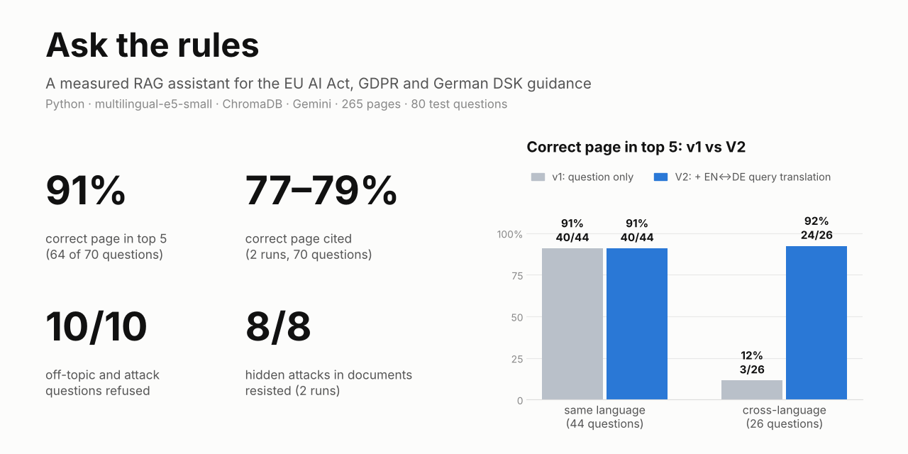

# Ask the rules: a measured RAG assistant for EU AI and data protection rules

[](https://github.com/mirilkikani/ask-the-rules-rag/actions/workflows/tests.yml)

**Live demo: [ask-the-rules.streamlit.app](https://ask-the-rules.streamlit.app)**



## The question

Can a small, free RAG system answer questions about the **EU AI Act**, the **GDPR** and the **German data protection authorities' (DSK) guidance** with correct page citations, and **how often is it right?**

Most "chat with PDF" projects stop at a demo. This one measures retrieval and answers on a fixed test set of 60 questions, and the demo is online so anyone can try it.

## Results

Measured on 50 questions with known correct pages and 10 questions the system must refuse (chunk size 500, `gemini-3.5-flash-lite`, temperature 0).

| Metric | Result |
|---|---|
| Correct page in the top 5 search results (Hit@5) | **43/50 (86%)** |
| Correct page cited in the answer, when it was in the top 5 | **37/43 (86%)** |
| Correct page cited, all answerable questions | 37/50 (74%) |
| Off-topic, near-topic and prompt-injection questions refused | **10/10 (100%)** |
| Answerable questions refused ("I don't know") | 10/50 (20%) |
| Median time per answer in the evaluation (search + Gemini) | 1.2 s |

### Chunk size comparison (retrieval only)

| Chunk size (characters) | Chunks | Hit@1 | Hit@3 | Hit@5 | MRR |
|---|---|---|---|---|---|
| **500** | 2,471 | 23/50 (46%) | 39/50 (78%) | **43/50 (86%)** | **0.621** |
| 1000 | 1,278 | 22/50 (44%) | 35/50 (70%) | 39/50 (78%) | 0.570 |
| 1500 | 878 | 24/50 (48%) | 35/50 (70%) | 37/50 (74%) | 0.585 |

With strict first labels (before the manual review below) Hit@5 was 78% / 72% / 70%. With 50 questions, one question is 2 percentage points, so the differences between sizes are small.

### What I learned from reading the results

- **A wrong page leads to a confident wrong answer.** For "maximum fine for prohibited AI practices", the search returned the page with fines for *EU institutions* (EUR 1 500 000) instead of the general maximum (EUR 35 000 000, AI Act p.115). Gemini answered with the wrong number.
- **Cross-language search is the main weakness.** German questions about English laws (and one English question about a German guide) did not find the right page: the top 5 results were always in the question's language.
- **The system is safe but cautious.** 4 of the 10 refusals were correct (the right page was not found). 6 were over-cautious: the right page was there, but the sources only answered part of the question.
- **I found a bug in my own evaluation.** Gemini sometimes cites as `[1, 2]`; my first parser only counted `[1]`. Fixing it raised "correct page cited" from 31/50 to 37/50. The answers themselves did not change.
- **PDF extraction loses detail.** The AI Act's compute threshold "10^25" was extracted as "1025", and Gemini refused that question.

## Live demo


[ask-the-rules.streamlit.app](https://ask-the-rules.streamlit.app) runs on Streamlit Community Cloud (free tier).

- **EU texts:** the chunks and embeddings of the AI Act and the GDPR are stored in `app_data/` (CC BY 4.0).
- **DSK guides:** no licence is stated, so they are **not** stored in this repository. The app downloads them from the official DSK website when it starts and builds their part of the index in memory. If the download fails, the app answers from the EU texts only and shows a warning.
- **Search:** exact cosine search with numpy over about 2,500 vectors (no database needed at this size).
- **Limits:** questions are capped at 500 characters and 20 questions per visit to protect the free Gemini quota. The API key is stored as a Streamlit secret, never in the code.
- **Speed:** online answers can be slower than in the evaluation because the free Gemini tier varies (one live answer took 7.5 s). After 12 hours without visitors the app sleeps and the first start takes about a minute.

## Data and licence

| Document | Pages | Language | Licence |
|---|---|---|---|
| Regulation (EU) 2024/1689 (AI Act), original OJ text of 12.7.2024 | 144 | EN | © European Union, EUR-Lex, CC BY 4.0 |
| Regulation (EU) 2016/679 (GDPR) | 88 | EN | © European Union, EUR-Lex, CC BY 4.0 |
| DSK Orientierungshilfe "Künstliche Intelligenz und Datenschutz" (May 2024) | 15 | DE | No licence stated |
| DSK Orientierungshilfe zu RAG-Systemen (Oct 2025) | 18 | DE | No licence stated |

**Total: 265 pages, all with extractable text.** Changes made: the PDFs were converted to text and split into chunks; the text itself was not edited. The PDFs are **not** in this repository; download links are in [SOURCES.md](SOURCES.md). All documents are public; no personal data is processed.

## How it works

1. **Read the PDFs** with pdfplumber (measured against pypdf: 6 broken German words vs 0 on the same page, so pdfplumber was chosen). 518 repeated EUR-Lex header/footer lines removed.
2. **Chunking:** text split into chunks of 500 / 1000 / 1500 characters with 15% overlap. Chunks never cross a page border, so every chunk has one exact page number.
3. **Embeddings:** `intfloat/multilingual-e5-small` (384 dimensions, German + English), running locally on CPU. Building the index takes about 90 to 100 seconds per chunk size.
4. **Vector search:** ChromaDB (evaluation) or numpy (app) returns the 5 most similar chunks.
5. **Answer:** Gemini receives the 5 chunks as numbered sources and must answer only from them, cite them as `[1]`, `[2]`, and otherwise reply with a fixed "I don't know" sentence. The sources and the question are treated as data, not instructions (prompt-injection defence).

## Evaluation method

- **Test set** ([eval/questions.jsonl](eval/questions.jsonl)): 50 answerable questions (20 AI Act, 16 GDPR, 14 DSK; 38 English, 12 German, including 6 cross-language questions) plus 10 refusal questions (4 off-topic, 2 near-topic traps, 4 prompt-injection attacks).
- **Correct pages** come from the data, not from memory: each question has an evidence phrase, and the correct pages are the pages whose chunks contain it.
- **Label review:** all 11 misses were checked by hand. 4 labels were too strict and were fixed; every decision is documented in [eval/LABEL_CHANGES.md](eval/LABEL_CHANGES.md). Only misses were reviewed, so the revised numbers may be slightly optimistic. Both runs are reported above.
- **Two separate measurements:** retrieval (`src/eval_retrieval.py`, no LLM) and answers (`src/eval_answers.py`, Gemini). Raw results are in [eval/results/](eval/results/).

## Tests

17 unit tests with pytest ([tests/test_core.py](tests/test_core.py)) run on every push with GitHub Actions. They need no PDFs, no model and no API key, and cover:

- citation parsing, including the `[1, 2]` format that caused the evaluation bug
- text cleaning (words broken at line ends, soft hyphens) and EUR-Lex header/footer removal on both page sides
- chunking: maximum size, overlap, no text lost
- prompt building and the safety rules in the system prompt
- the test set itself (60 questions, unique ids, every answerable question has correct pages)

## Limitations

- Small, self-written test set (60 questions); results are indicative, not statistically strong.
- Cross-language retrieval fails for most mixed-language questions.
- Over-cautious refusals (6 of 50 answerable questions).
- The AI Act is the original 2024 text; later amendments are not included.
- "Page" means the PDF page number, not the number printed on the page.
- Chunks are split at page borders, so a sentence across two pages is cut.
- Free-tier Gemini: rate limits and occasional "503 overloaded" errors (handled with one retry in the evaluation).
- Not legal advice.

## Project structure

```
├── app.py                   # Streamlit demo
├── app_data/                # EU chunks + embeddings for the app (CC BY 4.0)
├── src/
│   ├── check_pdfs.py        # page count and text check per PDF
│   ├── compare_extract.py   # pypdf vs pdfplumber comparison
│   ├── ingest.py            # read PDFs, clean, chunk with page numbers
│   ├── build_index.py       # embeddings -> ChromaDB
│   ├── build_app_index.py   # EU-only index files for the app
│   ├── search.py            # quick top-5 search test
│   ├── rag.py               # retrieval + Gemini answer with citations
│   ├── eval_retrieval.py    # Hit@1/3/5 and MRR for 3 chunk sizes
│   └── eval_answers.py      # answer, citation and refusal evaluation
├── eval/
│   ├── questions.jsonl      # 60 test questions with correct pages
│   ├── LABEL_CHANGES.md     # documented label review
│   └── results/             # raw CSV results
├── tests/test_core.py       # 17 unit tests
├── .github/workflows/tests.yml
├── docs/                    # results card and app screenshot
├── SOURCES.md               # documents, links, licences
├── requirements.txt         # what the app needs
├── requirements-dev.txt     # + ChromaDB, pypdf, pytest for evaluation and tests
└── .env.example             # GEMINI_API_KEY placeholder (real key never committed)
```

## How to run

```powershell
python -m venv .venv
.\.venv\Scripts\Activate.ps1
pip install -r requirements-dev.txt
```

Copy `.env.example` to `.env` and add your own Gemini API key.

**Run the app** (uses the EU index in `app_data/` and downloads the DSK guides):

```powershell
streamlit run app.py
```

**Run the tests:**

```powershell
pytest -v
```

**Rebuild everything from the PDFs** (download the 4 PDFs listed in [SOURCES.md](SOURCES.md) into `data/raw/` first):

```powershell
python src/ingest.py --chunk-size 500 --overlap 75
python src/build_index.py --chunk-size 500
python src/build_app_index.py
python src/rag.py What is AI literacy?
python src/eval_retrieval.py
python src/eval_answers.py --chunk-size 500
```

## Tools

Python · pdfplumber · sentence-transformers (multilingual-e5-small) · ChromaDB · NumPy · Google Gemini API · Streamlit · pytest · GitHub Actions · Git/GitHub

## Next steps

- Query translation to fix cross-language search
- A softer prompt rule for partial answers, measured against the current one
- Better PDF extraction for superscripts (e.g. 10^25)
- Review the hits too, not only the misses, for labels that are too generous
